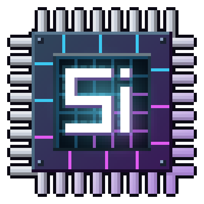

# Silicon Age: From Wafer to ExoTech

  

**[Русский](#русский) | [English](#english)**

---

## Русский

Технический мод для Minecraft 1.7.10: путь от кремниевой пластины до экзотехнологий. Вы добываете руды, строите производство полупроводников и энергосеть, а в конце собираете энергетическую броню, клинки, буры и защитные поля.

> ⚠️ **Бета-версия.** Основное содержимое готово, идёт доводка и исправление ошибок. Возможны баги — делайте резервные копии миров.

### Возможности
- **Производство полупроводников:** цепочка от кварца и руд до кремниевых пластин, кристаллов, чипов и контроллеров. 32 машины уровней LV–IV, улучшения машин, брак и побочные продукты.
- **Руды и переработка:** 16 руд, дробление, промывка, центрифуга, химия и жидкости; ванильные руды тоже идут в машины (железо и золото — около 2,5 слитка с руды: мойка и центрифуга иногда дают лишнюю пыль); у побочных металлов (германий, индий, цинк, палладий) есть свои рецепты. **22 блока металлов** из слитков мода (9 слитков ↔ блок, основание маяка; прокатный станок прессует блок из слитков любого мода).
- **Электропечь (LV) и индукционная печь (MV):** плавят всё, что обычная печь, без топлива; индукционная — два предмета сразу и разогрев до x3; опыт копится в печи.
- **Электролиз и тяжёлая вода:** водород и кислород из воды, тяжёлая вода и дейтерий для термоядерных реакторов.
- **Энергия LV → SV:** восемь уровней напряжения — LV, MV, HV, EV, **IV**, **QV (Квант)**, **XV (Экзо)** и **SV (Сингулярный)** до 131 072 EU/t.
  - Кабели каждого уровня с потерями, от медного до **сингулярного**; подсказка показывает пакет и общую пропускную способность; кабель под слишком высоким напряжением сгорает с дымом (и под IC2 — сразу).
  - Трансформаторы до XV↔SV, энергонакопители до ~2,1 млрд EU, **зарядные плиты**, модуль трансформатора и **универсальный модуль трансформатора** (машина или накопитель принимает любое напряжение).
- **Генераторы (22):** твердотопливный, водяное колесо, ветрогенератор, РИТЭГ, термоэлектрический, геотермальный, водородный топливный элемент, внутреннего сгорания (дизель, нефть, биотопливо…), солнечные панели от кремниевых до Нано / Квант / Экзо, паровая и газовая турбины, плазменный генератор, термоядерный реактор, **токамак**, **Токамак XV**, **экзо-сингулярный реактор** и **Сингулярный реактор**. Модули «Форсаж» и «Экономайзер».
- **Токамак XV — мультиблок 7x7x3:** 65 536 EU/t (XV). 24 катушки, оболочка из свинца, порты в стене: баки мода (жидкий гелий, водород, аргон, дейтерий) и энергохранилища. Стабильность плазмы, мягкая остановка аргоном, срыв с выбросом катушек и вспышкой излучения. Своё большое окно: схема постройки по слоям, чек-лист перед розжигом, индикаторы баков, сводка. Рядом с приёмником SV отдаёт SV одним пакетом.
- **Сингулярный реактор — мультиблок 7x7x5:** 131 072 EU/t (SV). Микро-чёрная дыра в двух кольцах гравитационных катушек; розжиг 700 млн EU из хранилищ-портов, дейтерий и капсула. Масса дыры: окно 40–70% — норма, лёгкая дыра мощнее, но может испариться; подача капсул вручную или «Авто». Гелий 12 мБ/т, удержание, мягкая остановка аргоном, выброс и испарение без разрушения мира. Своё окно и [схема постройки](docs/singular-build-layers.png) ([объёмный вид](docs/singular-build-3d.png)).
- **Компрессор материи (IV):** сжимает обычные предметы в «массу» (тяжёлые металлы — x4), 576 массы — капсула сжатой материи, топливо Сингулярного реактора; ценное и предметы с данными не принимает. Режим **«жидкая материя»**: вместо капсулы — 100 мБ сингулярной материи во внутренний бак (трубы, ведро, ячейка). Работающий Сингулярный реактор тоже понемногу собирает сингулярную материю.
- **Беспроводная энергия:** передатчики и приёмники LV–SV (связь картой, дальность и потери по уровню) и **квантовый транслятор** — до 32 768 EU/t без потерь в любое измерение на паре запутанных кристаллов.
- **Радиация:** РИТЭГ и реакторы излучают, свинец и вода экранируют, доза копится и вызывает эффекты. Защита: свинцовые блоки и стекло, свинцовый кожух, свинцовый костюм, радиационный щит брони и поля, дозиметр, радиопротектор, дезактивационный душ.
- **Переносные аккумуляторы LV–SV:** от кремниевой батарейки (40 000 EU) до «Сингулярного ядра» (16 млрд EU); режимы Shift + ПКМ — заряжать броню, предмет в руке или всё с собой. **Слот аккумулятора** под шкалой энергии у всех машин, карьеров и генератора поля (питает их) и у генераторов (заряжается выработкой); автоматика кладёт и забирает аккумуляторы.
- **Кнопка питания и красный камень** у машин, генераторов, накопителей, карьеров и генератора поля: выключенный блок не берёт энергию и не работает. Машины, накопители, генераторы и реакторы, генератор поля, карьер, душ и передатчики **ставятся выключенными** — длинную линию можно строить без риска взрыва.
- **Кремниевый карьер LV–EV и Экзо-буровая установка (XV):**
  - Своё меню из 7 вкладок, область с картой и лазерной рамкой в мире, сменные головки бура.
  - **24 модуля**: скорость, удача, шёлковое касание, дробление, промывка, центрифуга, насос, магнит, радиус, жила, двойной бур, утилизатор, защита от жидкостей, мягкий режим, ремонт головки, энергоэкономия, **расширенный бак**, **насосная жила**, **удержание чанков** и другие. Слоты модулей растут с уровнем.
  - **Насос с баком из отсеков** (до 4 жидкостей) и вкладка **«Баки»**: сторона выдачи, очистка за энергию, закрепление жидкости, автовыдача, фильтр жидкостей, действие при полном баке. Насос забирает водоём целиком, «бесконечная» вода не восстанавливается.
  - Экзо-установка лазером поднимает руду из недр; линзы руды, резонатор, стабилизатор и глубинный сканер (руды других модов).
- **Ключи трёх уровней:** поворот машин, демонтаж с сохранением заряда и содержимого, копирование настроек.
- **Обзор сети:** Shift + ПКМ ключом по кабелю — голограмма всей сети: кабели по нагрузке (узкие места и перегрузка — красным), источники, потребители, накопители и трансформаторы, панель с выработкой, потреблением и потерями.
- **Логистика:** связки кабелей, труб и пневмотрубок в одном блоке (как в Ender IO), фильтры предметов, переносные баки.
- **Энергоброня Нано / Квант / Экзо:** больше 20 функций (полёт, ночное зрение, сканеры руд и существ, солнечная плёнка, щит, восстановление, импульс уничтожения и другие), чипы, режимы питания, нагрев, бонусы полного комплекта.
  - У каждого комплекта свой стиль и объёмные детали на модели.
  - Огни брони светятся в темноте и показывают заряд. Цвет огней выбирается, есть аура полного комплекта.
  - Все функции включаются и назначаются на клавиши в меню **K**.
- **Газы брони («Система жизнеобеспечения»):** жидкий гелий (охлаждение), кислород (дыхание, в том числе в космосе Galacticraft), водород (полёт и рывок), аргон, криптон, тяжёлая вода и дейтерий. **Строгие газы:** каждая функция работает только при своём газе, без него она серая с подсказкой. Квант и Экзо без гелия уходят в **аварийный режим** (только HUD, защита как у железной брони). Заправка — из ячеек и вёдер в меню K или на станции.
- **Меню брони (K) переделано:** строка состояния (заряд, нагрев, режим, аварийный режим), все 4 части с полосками газов, у каждой функции — её газ и кнопка клавиши, вкладка «Газы» с запасом времени и кнопкой «Заправить всё»; подстраивается под маленькие экраны.
- **Станция обслуживания брони (MV):** 4 слота брони, 8 баков газов, заряжает и заправляет броню в слотах и того, кто стоит на станции; трубы, вёдра, ячейки, модули ускорения, трансформатора и расширенного бака.
- **Сингулярная броня — четвёртый костюм:** защита 5/10/8/5, 64 млн EU в каждой части, зарядка SV, все функции Экзо на 20% меньше газа и **около 20 своих функций**: гравитационный полёт, магнит, гравитационный якорь, антигравитация и спасение из Пустоты, горизонт событий, фазовый рывок, гравитационный пресс и захват, замедление времени, чёрная дыра, гравитационный купол, режим сингулярности, резонанс, гравитационный сканер, чувство угрозы, анализатор и другие. Новый газ — **сингулярная материя**.
  - **Уровни 1–5** у каждой части: очки за газы, полёт, бои и исследование мира, задания на каждый уровень, бонусы уровня и синхронизации, ветки выбора на уровнях 3 и 5.
  - **11 цветовых схем**, **профили функций** «Бой / Шахта / Полёт» (клавиша **P**), откаты функций на экране, вкладка «Уровень» в меню K.
- **Сингулярная станция обслуживания (SV):** всё от станции брони плюс **модернизация** частей до следующего уровня, **преобразование** Экзо-брони в сингулярную, смена ветки, **перенос** уровня на новую часть, **синхронизация** отстающих частей, выбор цветовой схемы. **Гравитационные стабилизаторы** рядом (до 4) и работающий Сингулярный реактор ускоряют процесс. Голограмма брони, вращающиеся кольца.
- **Наземный и Космический мост:** кольцо из гравитационных катушек открывает портал **мгновенно в любую точку** (Космический — в другое измерение), на земле или **в воздухе** с мягкой посадкой. Контроллер, конденсатор сингулярности, энергопорт и газовый порт, модули (навигационный компьютер, компенсатор массы, охладитель кольца, щит портала, маяк-приёмник, межпространственный якорь).
  - **Пульты** с пятью режимами («Домой», «От меня в точку», «С базы удалённо», «Забрать друга», «Ко мне»), **координатор** точек, закладки, друзья и согласие на перенос.
  - **Связь с сингулярной бронёй:** модуль в шлеме, вкладка «Мост» в меню K, клавиши **H** / **J**.
  - Износ и ремонт кольца, стабильность, перегрев, помехи, «знакомые места» и разброс выхода.
- **Преобразователь энергии:** EU ⇄ **RF**, **джоули Mekanism** и **gJ Galacticraft** (с картами Mekanism и Galacticraft), курсы и потери в конфиге, режим каждой грани, модули. Необязателен: без этих модов у него нет рецепта, а поставленный работает как буфер EU.
- **ПЭ-1 «Подавитель электроники»** — энергопушка без урона против энергоброни. **«Точка»** гасит часть брони, куда попал луч (голова / корпус / ноги), **«Импульс»** после набора 3 с гасит всю броню (16/14 с у Нано … 8/6 с у Сингулярной, затем 20 с невосприимчивости), **«Сифон»** перекачивает заряд брони цели в ваш аккумулятор, броню или пушку — 6/5/4/3% полного заряда в секунду у Нано/Квант/Экзо/Сингулярной, лишнее сбрасывается, на перегреве поток слабеет до 25%. Попадания греют броню цели и ускоряют выкипание гелия. 5 модулей, улучшение ПЭ-1М, вкладка в меню **K**, 3D-модель. Дешевле Нано-нагрудника — шанс для слабой брони. Защита: Защитный чип, аварийная перезагрузка, флаг поля «ЭМИ-экран». Учитывает PvP и «своих», работает и в чужих приватах (сервер может запретить).
- **Подложка (Si-14) — своё измерение для поздней игры:** мир-микросхема по ту сторону прокола Космического моста; каждый поход — экспедиция. Сервер, мультиплеер и совместимость — в разделе «Подложка (Si-14)» ниже.
  - *Мир:* прямые Скрайб-каньоны каждые 256 блоков, Кремниевые плато, своя порода (Кристаллит, окисная корка, Медные трассы, друзы) и руды мода — редкие богаче, чем дома; ни камня, ни деревьев, ни ванильных руд. Опасные биомы — Кварцитовые гряды (хребты до Y 140, самые богатые жилы), Окисные поля с фоновой радиацией и Разлом с парящими островами. Своя погода: ЭМИ-буря гасит броню мода под открытым небом, Кремнезёмная мгла, раз в неделю — Сингулярный выброс.
  - *Поселения Наладчиков:* купола вечного поля — Пост, Посёлок, Город, у точки входа — «Первый причал». «Терминал обмена», Кредит-чипы, репутация «Доверие», контракты Старейшины, Причалы для точной посадки моста, Капсула возврата, Карта поселений, Метка гибели в целях моста. Энергетик, Оружейник и Скупщик; ночные налёты Отступников и караваны с засадами.
  - *Враги в настоящей броне мода:* Обходчики, Мародёры, Отступники в краденой Квантовой и Экзо-броне (Штурмовик, Глушитель — у каждого 50-го настоящий ПЭ-1 с предупреждением, Экзо-палач), Пустые оболочки с дронами, рой нанитов, мимики-станки, Кварцитовый колосс и другие, элита с модификаторами. У брони мобов есть запас — её «сажают» стрелами и плазмой, а **ПЭ-1 подавляет и выкачивает** (Точка, Импульс, Сифон).
  - *Стражи куполов — серьёзные противники:* их броня работает как у игрока того же уровня (обшивка гасит 80–100% удара, запас 800–3000, щит, регенерация, подзарядка куполом). **ПЭ-1 действует на стражей во всех режимах** — под Импульсом бой короче в 2–11 раз, но любой выстрел по стражу — провокация.
  - *Руины и добыча:* Мёртвые Узлы на перекрёстках каньонов, заброшенные литографии под плато, обломки мостов Литографов, лагеря Отступников под Краденым генератором поля, запечатанные Хранилища с Сингулярным часовым. Трофейная броня и оружие восстанавливаются у Оружейника или на своей Станции обслуживания; из мира — не больше 3 Крупиц сингулярности в сутки. Вещи погибшего собирает Утилизатор — убейте его, и всё выпадет.
  - *Финал — Смотритель Пробоя:* Ключ Пробоя из 4 Фрагментов будит в Эпицентре Пробоя босса в три фазы с ПЭ-1М и «Импульсом глушения»; HP растёт с числом игроков, добыча у каждого своя (Матрица Пробоя, Крупицы сверх лимита, Сгустки, трофеи, Схема окраски «Литограф»). 12 Журналов Литографа, Сигнал Литографов, Модуль Литографов (−50% к содержанию поля), новые задания Сингулярного прогресса, глава «Подложка» в справочнике.
- **Энергоклинки** трёх уровней: режущая кромка, энергоблок, широкий взмах, энергетическая волна, «Добыча» до V.
- **Электробуры** трёх уровней: площадь 3x3 и 5x5, туннель, жила, шёлковое касание, удача до V, автоплавка, лазер, связь с сундуком. Питаются от надетой брони.
- **Сингулярный клинок и Сингулярный бур (SV):** получаются из Экзо-клинка и Экзо-бура в Сингулярной станции, растут до уровня 5, ветки на выбор, цветовые схемы; газы берут из баков надетой брони.
  - Клинок: **6 форм** (Shift + колесо) — Меч, Коса, Копьё, Хлыст-клинок, Щит-клинок, Сингулярная, у каждой своя особая атака; гравитационный рывок и привязка, разрез пространства, идеальное парирование, контратака, заряженный удар, гравитационный щит, «Последний шанс»; ветки «Разрушитель», «Дуэлянт», «Страж». Уважает PvP-настройки и приваты.
  - Бур: режим **«Чёрная дыра»** 5x5 / 9x9 / 12x12 (и туннель) — уничтожает зону, кроме бедрока, блоков с содержимым и чужих приватов, и даёт **крупицы сингулярности** (поставленные игроком блоки не считаются); гравитационная воронка, сундук добычи в любом измерении, осушение, замена блоков, фазовое копание.
  - **Крупицы** и **сгусток сингулярности**: очки уровня бура, оплата модернизации в станции, 100 мБ сингулярной материи в Компрессоре.
- **Генератор поля:** кластер до 8 узлов, 5 форм поля.
  - Защита от мобов, снарядов и взрывов.
  - Запрет спавна, приватная зона со списком доступа (защищены и животные, рамки, вагонетки; переключатель «Запретить механизмы» — двери, рычаги, кнопки), лечение союзников; поле нельзя развернуть поверх чужого, даже выключенного.
  - **Беспроводная зарядка** предметов мода, IC2 и RF: модуль усилителя, приоритет, резерв буфера, искры.
  - Модули энергонакопителя и трансформатора, управление редстоуном, схема поля в экране генератора.
  - Вкладка **«Зона»**: радиус, высота, смещение, центр и форма поля с предпросмотром; граница, бегущий пунктир, анимация, яркость, лучи между узлами, гудение, три цвета RGB и 24 готовых цвета.
  - **Защита от дождя:** внутри поля нет дождя и снега, вода не замерзает, молнии гасятся.
  - Режимы беспроводной зарядки: всё сразу, сначала броня / рука, самые разряженные или почти полные, порог «заряжать ниже N%».
- **Меню-голоэкраны:** у каждой машины и генератора свой экран с анимированной сценой процесса (дробилка, CVD, степпер, турбины, реакторы, солнечные панели…), шкала энергии с процентами, полноразмерные баки с текстурой жидкости; тот же стиль у карьера, генератора поля и страниц NEI.
- **Энергонакопители:** компаратор, выход поворачивается ключом, слот разрядки, модули (трансформатор, объём, форсаж, **расширитель выхода** — до 3 выходных граней, **адаптивный трансформатор** — повышает выход до уровня самого слабого потребителя, **универсальный трансформатор**), до 4 слотов зарядки на старших уровнях.
- **Жидкости:** вёдра для всех 22 жидкостей мода, заливка и слив ведром или капсулой по машине, модуль расширенного бака и очистка баков за энергию.
- **Иллюстрированный справочник инженера:** 14 разделов плитками, больше 175 статей с иконками предметов, сетками крафта, рецептами машин, картами руд, схемами мультиблоков и рисунками; **поиск по всему тексту** (Ctrl+F или «/», список найденного с подсветкой), **закладки**, «первые шаги» с галочками. **«Путь развития»** с маршрутами по уровням энергии, реакторам и броне, раздел **«Компоненты»** (все детали и материалы: где делаются и куда идут), **«Справочная»** (клавиши, совместимость, жидкости и газы, все модули), отдельный раздел о мосте. У каждого предмета мода есть статья. Выдаётся при первом крафте любого предмета мода.
- **Звуки** работающих машин и генераторов, **WAILA** для всех блоков, **настройки баланса** в конфиге (скорость и расход машин, ёмкости, дальность беспроводной энергии и другое); на сервере настройки приходят игрокам с сервера; список измерений, где генерируются руды (`worldgen.oreDimensions`). Блоки с содержимым ломаются только киркой — рукой ничего не потеряешь; карьер, генератор поля, беспроводные блоки и преобразователь с владельцем ломает только владелец (и оператор). Снятые ключом машины, генераторы и накопители сохраняют улучшения и режимы, а крафт улучшенного блока переносит заряд, баки и настройки.
- **Настройки сервера:** раздел `energy` — взрывы машин от перегрузки (можно выключить: блок только дымит), сила взрыва, разрушение блоков; `bridge` — мосты вкл/выкл, переходы в другие измерения, множитель цены; `singular` — множители EU, газов, времени и очков Сингулярной брони и станции; `balance.ic2CableCurrentLimit` — кабели под IC2 горят и от превышения тока. Клиентские настройки (звук, проверка обновлений, сообщение о сайте) сервер не перезаписывает.

### Управление
| Клавиша | Действие |
|---|---|
| **K** | Меню брони, клинка, бура и режима питания: функции и их клавиши |
| **R** | Рывок (Экзо-поножи) |
| **P** | Следующий профиль функций (Сингулярная броня) |
| **H** / **J** | Мост «Домой» / к последней цели (шлем со связью с мостом), Shift + J — запомнить место |
| **G** | Статья справочника о предмете под курсором в инвентаре (или в руке) |
| **Ctrl+F** или **/** | Поиск в справочнике |
| **Shift + колесо** | Форма Сингулярного клинка / режим Сингулярного бура / режим ПЭ-1 |
| **Гаечный ключ** | ПКМ — повернуть механизм, Shift + ПКМ в воздух — сменить режим (у электро- и квантового ключа), Shift + ПКМ по кабелю — обзор сети (ещё раз — обновить, Shift + ПКМ в воздух — скрыть) |
| **Shift / Ctrl** | Подробности и управление в подсказках предметов |

### Требования и установка
1. Minecraft **1.7.10**, Forge **10.13.4.1614** (или новее для 1.7.10), Java 8.
2. Скачайте `SiliconAgeBeta-0.2.2.jar` на странице [Releases](../../releases) и положите в папку `.minecraft/mods`.

### Подложка (Si-14): сервер, мультиплеер, совместимость
- **Вход:** только Космическим мостом (цена туда и обратно ×0,5, `dimension.bridgeCostMultiplier`) и «Прыжком» корабля аддона Vehicles. Попавший иначе (чужие телепорты) на следующем такте возвращается назад (`dimension.strictEntry`); творческий режим и операторы проходят. Адский портал и кровать там не работают, после гибели — возрождение в Верхнем мире. С `dimension.requireSignal = true` Подложку в мосту видит только применивший «Навигационную запись Si-14».
- **Одинаковый jar и одинаковые id измерения на клиенте и сервере** (в игре по LAN — у хоста и гостя): раздел `dimension` в `config/SiliconAge.cfg` — `dimensionId` / `providerId` (−1414) и id биомов `biomeIdPlateaus`, `biomeIdCanyons`, `biomeIdRidges`, `biomeIdOxide`, `biomeIdRift` (240–244). Иначе клиент предупредит в чате, а биомы покажутся неверно. Менять id можно только до первого входа в мир. Если id измерения занят другим модом, Подложка выключается (в логе строка `Si-14 Substrate is OFF`), занятый id биома сдвигается на свободный сам. Остальные правила раздела клиент получает от сервера.
- **Новые структуры и биомы появляются только в неоткрытых землях.** Поселения, руины, лагеря, Хранилища, арены и новые биомы строятся там, где ещё нет ни одного чанка; созданная земля не меняется. В мире 0.2.1 ищите их дальше от исследованных мест (у старой точки входа может не оказаться «Первого причала»).
- **Galacticraft и GalaxySpace:** Подложка — не планета: ракеты туда не садятся, кислород, гравитация и небо GC её не касаются. Взлететь отсюда на ракете можно; чтобы запретить, добавьте `-1414` в список «Dimensions where rockets cannot launch» в `config/Galacticraft/core.conf` (чужие конфиги мод сам не правит).
- **Ender IO, Draconic Evolution, AE2, Thaumcraft:** мобы с яиц, спавнеров и мясорубок дают только опыт, банка душ Ender IO на них не работает. Чтобы их нельзя было и размножать, внесите в чёрные списки банки душ (`soulVesselBlackList`), Powered Spawner и спавнера / Mob Grinder DE существ Подложки: `SiliconAge.lineman`, `marauder`, `trooper`, `jammer`, `hollowShell`, `repairDrone`, `executioner`, `nanite`, `sentryDrone`, `mimic`, `overheated`, `warlord`, `sentinel`, `eclipse`, `phantom`, `leech`, `colossus`, `strider`, `scrapper`, `waferCrab`, `breakdownWarden`, `containmentCoil`, `caravanMaster`, `caravanGuard`, `tuner`, `warden` (все с префиксом `SiliconAge.`). AE2 Spatial IO не забирает Ядро поселения, блоки арены и другие ключевые блоки; узлов Thaumcraft, метеоритов AE2 и руд других модов в Подложке нет.
- **Мультиплеер:** «Доверие», лимиты сделок, контракты, Метка гибели, лимит Крупиц, откат добычи Смотрителя, Схемы окраски и Навигационная запись — у каждого игрока свои (по UUID). HP Смотрителя растёт с числом игроков рядом (одному 600, вдвоём 960), добыча — каждому, кто нанёс от 10% урона. Без игроков ничего не моделируется; мир выгружается через ~20 с после ухода последнего (`keepLoaded`).
- **«Пробой» — единственное исключение в защите брони:** удары «Пробоя» (Экзо-палач, Капитан купола, «сброс ядра» Смотрителя и др.) проходят энергощит Экзо- и Сингулярной брони. Спасают дистанция, укрытие и Точка ПЭ-1 во время замаха.
- **Ключи раздела `dimension`:** `enabled`, `strictEntry`, `villages`, `raids`, `caravans`, `empStorms` (погода), `mobsUseEmp` (ПЭ-1 у мобов), `empMobTargets` / `siphonMobs` (ПЭ-1 по мобам) — по умолчанию `true`; `requireSignal`, `keepLoaded`, `nativesCrossBridge`, `guardsAggroOnViolations` — `false`; `bridgeCostMultiplier` 0.5, `gearDropMultiplier` 1.0, `respawnDimension` 0. `customSky` (`false`) — опция клиента, не сервера: своё небо Подложки.

### Моды, которые помогут (необязательны)
| Мод | Что даёт вместе с Silicon Age |
|---|---|
| **IndustrialCraft 2 Experimental** (2.2.828+) | Общая энергосеть с машинами и кабелями IC2, зарядка брони, клинков и буров в зарядниках IC2, зарядные плиты и генератор поля заряжают и предметы IC2 |
| **Not Enough Items** + **CodeChickenCore** | Страницы рецептов всех машин и генераторов (с жидкостями, шансами и EU/t), переход к рецептам из экрана машины, страницы «Как получить» для всего, что не крафтится (руды, крупицы, чужие жидкости) |
| **WAILA** (1.5.10) | Подсказка при наведении: заряд, выработка, прогресс машин, жидкости в баках, беспроводная связь, излучение |
| **Industrial Upgrade** | «Форсаж» и расширитель выхода работают и в накопителе, который питает сеть IC2 |
| **Galacticraft** | Шлем с включённым дыханием и кислородом в баке заменяет кислородное снаряжение; преобразователь энергии меняет EU на gJ |
| **BuildCraft**, **Thermal Expansion** (CoFH), **Ender IO** и другие RF-моды | Их гаечные ключи поворачивают машины и работают на трубах и связках Silicon Age; генератор поля заряжает их RF-предметы; преобразователь энергии меняет EU на RF |
| **Mekanism** (не проверено) | Преобразователь энергии меняет EU на джоули Mekanism и работает с его кабелями. Совместимость написана по API, в игре с Mekanism не проверялась |

**Сборки с UniDict** (объединение металлов): слитки и блоки мода заменяются вариантом главного мода сборки — все рецепты мода их принимают, блоки металлов мода прессуются в прокатном станке, реакторы строятся из свинца любого мода. Крафты мода проверены против большой сборки (Thermal, Ender IO, IC2, AE2, Forestry и др.) — пересечений нет.

**Проверка обновлений:** раз за запуск игры мод запрашивает номер последней версии с silicon-age.site и, если вышла новая, пишет об этом в чат (на сервере — операторам и в лог). О игроке ничего не отправляется; выключается в конфиге: `updates.check = false`.

**Сайт мода — [silicon-age.site](https://silicon-age.site/):** гайды для новичков, справочник по всем машинам, генераторам, броне и мостам, калькулятор, сравнение техники, карта руд, все настройки конфига и FAQ. При входе в мир мод напоминает о нём в чате со ссылками; выключается в конфиге: `site.message = false`.

**Для администраторов серверов:** перед осмотром сети ключом, переходом через мост, чутьём Сингулярной брони и включением приватной зоны генератора поля Silicon Age спрашивает моды приватов через `BlockEvent.BreakEvent` от ненастоящего игрока `com.sc.handler.NetViewNetSC$ProbePlayerSC` (FakePlayer с профилем игрока или владельца). Блок при этом не ломается — логгерам, квестам и статистике стоит игнорировать такие события (`instanceof ProbePlayerSC` / `NetViewNetSC.ProbePlayerSC.isProbe`). Проверку для поля можно выключить в конфиге: `balance.fieldClaimCheck = false`.

MJ, Universal Electricity и Botania не поддерживаются.

### Сборка из исходников
1. Нужны JDK 8 и Gradle 2.14 (ForgeGradle 1.2).
2. Положите в папку `libs/` jar-файлы для компиляции (в репозиторий они не входят, в мод не упаковываются):
   - `industrialcraft-2-2.2.828-experimental.jar`, `NotEnoughItems-1.7.10-1.0.5.120-universal.jar`, `CodeChickenCore-1.7.10-1.0.7.48-universal.jar`, `CodeChickenLib-1.7.10-1.1.3.141-universal.jar`, `Waila-1.5.10_1.7.10.jar`;
   - `GalacticraftCore-1.7-3.0.12.504.jar`;
   - `rf-api-compileonly.jar` — классы `cofh/api/energy` из любого мода, который включает RF API (например, Industrial Upgrade или CoFH Core): распакуйте папку `cofh/api/energy` и упакуйте её в jar (`jar cf libs/rf-api-compileonly.jar cofh/api/energy`);
   - `mekanism-api-stub-compileonly.jar` — заглушка API Mekanism, собирается скриптом `tools/mekanism-api-stub/build.sh` (из корня проекта, после первой сборки ForgeGradle).
3. Выполните `gradle build`. Готовый jar появится в `build/libs/`.

### Лицензия
© 2026 Aleksandr. Все права защищены. Код открыт для просмотра; копирование, изменение — только с разрешения автора. Разрешено использовать мод в сборках и распространять.

---

## English

A tech mod for Minecraft 1.7.10: the way from a silicon wafer to ExoTech. You mine ores, build semiconductor production and an energy network, and end up with energy suits, blades, drills and protective fields.

> ⚠️ **Beta.** The main content is in; polishing and bug fixing go on. Bugs are possible - back up your worlds.

### Features
- **Semiconductor fabrication:** a chain from quartz and ores to silicon wafers, crystals, chips and controllers. 32 machines from LV to IV, machine upgrades, defects and by-products.
- **Ores and processing:** 16 ores, crushing, washing, centrifuge, chemistry and fluids; vanilla ores go into the machines too (iron and gold - about 2.5 ingots per ore: the washer and centrifuge sometimes give an extra dust); by-product metals (germanium, indium, zinc, palladium) have their own recipes. **22 metal blocks** from the mod's ingots (9 ingots ↔ a block, a beacon base; the Rolling Machine presses a block from any mod's ingots).
- **Electric Furnace (LV) and Induction Furnace (MV):** they smelt everything a furnace does, without fuel; the induction one takes two items at once and heats up to x3; smelting XP is stored in the furnace.
- **Electrolysis and heavy water:** hydrogen and oxygen from water, heavy water and deuterium for the fusion reactors.
- **Energy LV → SV:** eight voltage tiers - LV, MV, HV, EV, **IV**, **QV (Quantum)**, **XV (Exo)** and **SV (Singular)**, up to 131,072 EU/t.
  - Cables for every tier with loss, from copper to **singular**; the tooltip shows the packet size and the total throughput; a cable under too high a voltage burns out with smoke (under IC2 too, at once).
  - Transformers up to XV↔SV, energy storages up to ~2.1B EU, **charge pads**, the transformer upgrade and the **universal transformer upgrade** (a machine or a storage takes any voltage).
- **Generators (22):** solid fuel, water wheel, wind turbine, RTG, thermoelectric, geothermal, hydrogen fuel cell, combustion (diesel, crude oil, biofuel...), solar panels from silicon up to Nano / Quantum / Exo, steam and gas turbines, plasma generator, fusion reactor, **tokamak**, **Tokamak XV**, the **Exo singularity reactor** and the **Singular Reactor**. Overdrive and Economizer upgrades.
- **Tokamak XV, a 7x7x3 multiblock:** 65,536 EU/t (XV). 24 coils, a lead shell, ports in the wall: the mod's tanks (liquid helium, hydrogen, argon, deuterium) and energy storages. Plasma stability, a soft stop with argon, a breakdown that throws coils out with a radiation burst. Its own large screen: the build's layers, a pre-ignition checklist, tank gauges, a summary. Next to an SV taker it gives SV as one packet.
- **Singular Reactor, a 7x7x5 multiblock:** 131,072 EU/t (SV). A micro black hole held by two rings of gravity coils; ignition takes 700 million EU from the port storages, deuterium and a capsule. The hole's mass: the 40-70% window is normal, a light hole gives more but may evaporate; capsules fed by hand or on Auto. Helium 12 mB/t, containment, a soft stop with argon, ejection and evaporation that never break the world. Its own screen and a [build guide](docs/singular-build-layers.png) ([3D view](docs/singular-build-3d.png)).
- **Matter Compressor (IV):** squeezes ordinary items into "mass" (heavy metals x4), 576 mass make a compressed matter capsule, the Singular Reactor's fuel; it refuses valuables and items with data. A **liquid matter** mode: 100 mB of Singular Matter into an inner tank instead of a capsule (pipes, bucket, cell). A running Singular Reactor slowly gathers Singular Matter too.
- **Wireless energy:** transmitters and receivers LV-SV (linked with a card, range and loss by tier) and the **quantum translator** - up to 32,768 EU/t lossless into any dimension through a pair of entangled crystals.
- **Radiation:** RTGs and reactors emit it, lead and water shield, the dose builds up and has effects. Protection: lead blocks and glass, the lead casing, the lead suit, the armour's and the field's radiation shields, a dosimeter, a radioprotector, a decontamination shower.
- **Portable batteries LV-SV:** from the silicon cell (40,000 EU) to the Singular Core (16B EU); sneak + right-click modes charge your armour, the held item or everything you carry. **A battery slot** under the energy gauge of every machine, quarry and the field generator (it powers them) and of the generators (their output charges it); automation puts batteries in and takes them out.
- **A power switch and redstone control** on machines, generators, storages, quarries and the field generator: a switched-off block takes no energy and does nothing. Machines, storages, generators and reactors, the field generator, the quarry, the shower and the transmitters are **placed switched off**, so a long line can be built with no risk of blowing up.
- **Silicon Quarry LV-EV and the Exo Drilling Rig (XV):**
  - A seven-tab screen, an area with a map and a laser frame in the world, swappable drill heads.
  - **24 modules**: speed, fortune, silk touch, crushing, washing, centrifuge, pump, magnet, radius, vein miner, twin drill, trash disposal, fluid guard, gentle mode, head repair, energy saver, **tank extension**, **fluid vein**, **chunk keeping** and more. Module slots grow with the tier.
  - **A pump with a compartment tank** (up to 4 fluids) and a **Tanks** tab: output side, clearing for energy, pinning a fluid, auto output, a fluid filter, what to do when full. The pump takes a whole body of water, so "infinite" water doesn't refill.
  - The rig's laser brings ore up from the deep; ore lenses, resonator, stabilizer and a deep scanner (other mods' ores).
- **Wrenches in three tiers:** turning machines, dismantling with charge and contents kept, copying settings.
- **Network overview:** sneak + right-click a cable with a wrench - a hologram of the whole network: cables by load (bottlenecks and overload in red), sources, consumers, storages and transformers, a panel with output, consumption and losses.
- **Logistics:** cable, pipe and pneumatic tube bundles in one block (Ender IO style), item filters, portable tanks.
- **Nano / Quantum / Exo energy suits:** 20+ functions (flight, night vision, ore and life scanners, solar film, shield, regeneration, annihilation pulse and more), chips, power modes, heat, full-set bonuses.
  - Each suit has its own style and 3D parts on the worn model.
  - The armour lights glow in the dark and show the charge. The light colour can be picked; a full set has an aura.
  - Every function is switched and key-bound in the **K** screen.
- **Suit gases ("Life Support"):** liquid helium (cooling), oxygen (breathing, in Galacticraft space too), hydrogen (flight and dash), argon, krypton, heavy water and deuterium. **Strict gases:** every function works only with its gas, without it the function is greyed out with a hint. Quantum and Exo without helium drop into **emergency mode** (HUD only, iron-armour protection). Refilling from cells and buckets in the K screen or at a station.
- **Armour screen (K) redesigned:** a status strip (charge, heat, power mode, emergency mode), all 4 pieces with their gas bars, every function shows its gas and a key button, a Gases tab with the time left and "Refuel all"; fits small screens.
- **Armour Service Station (MV):** 4 armour slots, 8 gas tanks, charges and refuels the suits in its slots and whoever stands on it; pipes, buckets, cells, overclocker, transformer and tank extension upgrades.
- **Singular armour, the fourth suit:** protection 5/10/8/5, 64M EU in each piece, SV charging, every Exo function on 20% less gas and **about 20 functions of its own**: gravitational flight, magnet, gravitational anchor, antigravity and void rescue, event horizon, phase dash, gravity press and grab, time slowing, black hole, gravity dome, Singularity mode, resonance, gravity scanner, threat sense, analyzer and more. A new gas, **Singular Matter**.
  - **Levels 1-5** for each piece: points for gases, flight, fights and exploring, tasks for every level, level and sync bonuses, branch choices at levels 3 and 5.
  - **11 colour schemes**, **function profiles** Combat / Mining / Flight (the **P** key), cooldowns on screen, a Level tab in the K screen.
- **Singular Service Station (SV):** all of the Armour Service Station plus **modernisation** of pieces to the next level, **conversion** of Exo armour into Singular, branch change, level **transfer** to a new piece, **sync** of lagging pieces, colour scheme choice. **Gravitational Stabilisers** nearby (up to 4) and a running Singular Reactor speed it up. A hologram of the armour, turning rings.
- **Ground and Space Bridge:** a ring of gravity coils opens a portal **instantly to any point** (the Space Bridge - into another dimension), on the ground or **in the air** with a soft landing. Controller, Singularity Capacitor, energy and gas ports, modules (navigation computer, mass compensator, ring cooler, portal shield, receiver beacon, interdimensional anchor).
  - **Remotes** with five modes (Home, From me to a point, From base remotely, Fetch a friend, To me), a **coordinator** for points, bookmarks, friends and consent to be moved.
  - **Singular armour link:** a module in the helmet, a Bridge tab in the K screen, the **H** / **J** keys.
  - Ring wear and repair, stability, overheating, interference, familiar places and exit scatter.
- **Energy Converter:** EU ⇄ **RF**, **Mekanism joules** and **Galacticraft gJ** (with the Mekanism and Galacticraft cards), rates and loss in the config, a mode for every face, upgrades. Optional: without those mods it has no recipe, and one already placed works as an EU buffer.
- **PE-1 "Electronics Suppressor"** - an energy gun that deals no damage, made against power armour. **Point** shuts down the armour piece the beam hits (head / body / legs), **Pulse** after a 3 s charge-up shuts down the whole suit (16/14 s on Nano ... 8/6 s on Singular, then 20 s immunity), **Siphon** pumps the target suit's charge into your battery, armour or the gun - 6/5/4/3% of its full charge a second on Nano/Quantum/Exo/Singular, the excess is vented, an overheated gun drops to 25%. Hits heat the target's suit and boil its helium faster. 5 modules, the PE-1M upgrade, a tab in the **K** screen, a 3D model. Cheaper than a Nano chestplate - a chance for weaker armour. Protection: the Defense chip, an emergency reboot, the field's "EMP screen" flag. Respects PvP and friends, works in other players' claims too (a server can forbid it).
- **The Substrate (Si-14) - a dimension of its own for the late game:** a chip-world beyond the Space Bridge's puncture; every trip is an expedition. Server, multiplayer and compatibility - in the "The Substrate (Si-14)" section below.
  - *The world:* straight Scribe Canyons every 256 blocks, Silicon Plateaus, its own rock (Crystallite, oxide crust, Copper Traces, druses) and the mod's ores - the rare ones richer than at home; no stone, no trees, no vanilla ores. Dangerous biomes - the Quartzite Ridges (crests up to Y 140, the richest veins), the Oxide Fields with background radiation and the Rift with floating islands. Weather of its own: the EMP storm suppresses the mod's armour under the open sky, the Silica Haze, once a week the Singular Emission.
  - *The Tuners' settlements:* domes of an eternal field - Outposts, Settlements, Cities, and the First Dock near the way in. An exchange terminal, Credit Chips, the Trust reputation, the Elder's contracts, docks for a precise bridge landing, the Return Capsule, the Settlement Map, the death mark on the bridge's targets. The Power Engineer, the Armourer and the Salvager; the Renegades' night raids and caravans with ambushes.
  - *Enemies in the mod's real armour:* Linemen, Marauders, Renegades in stolen Quantum and Exo armour (the Trooper, the Jammer - one in 50 carries a real PE-1 and warns first, the Exo Executioner), Hollow Shells with drones, nanite swarms, mimic machines, the Quartzite Colossus and more, elites with modifiers. Mob armour has a reserve - arrows and plasma wear it down, and **PE-1 suppresses and drains it** (Point, Pulse, Siphon).
  - *The dome wardens are serious opponents:* their armour works as a player's of the same tier (the plating stops 80-100% of a blow, a reserve of 800-3000, the shield, regeneration, recharging from the dome). **PE-1 works on the wardens in all modes** - under a Pulse the fight is 2-11 times shorter, but any shot at a warden is a provocation.
  - *Ruins and loot:* Dead Nodes on the canyons' crossings, abandoned lithographs under the plateaus, the wrecks of the Lithographers' bridges, Renegade camps under a Stolen Field Generator, sealed Vaults with a Singular Sentinel. Trophy armour and weapons are restored at the Armourer or at your own Service Station; at most 3 Singularity Crumbs a day from the world. A Scrapper Crab gathers a dead player's things - kill it and everything drops.
  - *The finale - the Breakdown Warden:* a Breakdown Key of 4 Fragments wakes a three-phase boss with a PE-1M and the Silencing Pulse in the Breakdown Epicentre; its health grows with the players, everyone's loot is their own (the Breakdown Matrix, Crumbs beyond the cap, Clots, trophies, the "Lithographer" paint scheme). 12 Lithographer's Journals, the Lithographers' Signal, the Lithographers' Module (-50% field upkeep), new Singular progress tasks, the handbook chapter "The Substrate".
- **Energy blades** in three tiers: cutting edge, energy block, wide sweep, energy wave, Looting up to V.
- **Electric drills** in three tiers: 3x3 and 5x5 areas, tunnel, vein, silk touch, fortune up to V, autosmelt, laser, chest link. Powered by the worn suit.
- **Singular Blade and Singular Drill (SV):** made from the Exo blade and drill in the Singular Station, grow to level 5, branches to choose, colour schemes; they take gases from the worn suit's tanks.
  - Blade: **6 forms** (sneak + wheel) - Sword, Scythe, Spear, Whip, Shield, Singular, each with its own special attack; gravity pull and tether, rift step, perfect parry, riposte, charged strike, gravity shield, Last Chance; Destroyer, Duelist and Guardian branches. Respects PvP settings and claims.
  - Drill: **Black Hole** mode 5x5 / 9x9 / 12x12 (and a tunnel) - destroys the zone but bedrock, blocks with contents and other claims, and gives **Singular Crumbs** (player-placed blocks don't count); gravity funnel, a loot chest in any dimension, drain, block replace, phase digging.
  - **Crumbs** and the **Singular Clot**: drill level points, paying for modernisation in the station, 100 mB of Singular Matter in the Compressor.
- **Field generator:** a cluster of up to 8 nodes, 5 field shapes.
  - Protection from mobs, projectiles and explosions.
  - No spawning, a private zone with an access list (animals, frames and carts protected too; a "No mechanisms" switch - doors, levers, buttons), healing of allies; a field can't be deployed over someone else's, even a switched-off one.
  - **Wireless charging** of the mod's, IC2 and RF items: a charge booster upgrade, priority, a buffer reserve, sparks.
  - Energy storage and transformer upgrades, redstone control, a map of the field on its screen.
  - A **Zone** tab: the field's radius, height, offset, centre and shape with a preview; outline, running dashes, animation, brightness, node beams, hum, three RGB colours and 24 ready colours.
  - **Rain shield:** no rain or snow inside the field, no water freezing, lightning put out.
  - Wireless charging modes: all at once, armour / held item first, emptiest or nearly full first, a "charge below N%" threshold.
- **Holo-screen menus:** every machine and generator has its own screen with an animated scene of its process (crusher, CVD, stepper, turbines, reactors, solar panels...), an energy gauge with the percentage and full-size tank gauges in the fluid's texture; the quarry, the field generator and the NEI pages share the style.
- **Energy storages:** comparator output, the output face turned with a wrench, a discharge slot, upgrades (transformer, capacity, overdrive, **output splitter** - up to 3 output faces, **adaptive transformer** - raises the output up to the weakest consumer's tier, **universal transformer**), up to 4 charge slots on the higher tiers.
- **Fluids:** buckets for all 22 of the mod's fluids, filling and draining machines with a bucket or a cell, a tank extension upgrade and clearing tanks for energy.
- **Illustrated engineer's handbook:** 14 chapter tiles, 175+ articles with item icons, crafting grids, machine recipes, ore cards, multiblock layouts and pictures; **full-text search** (Ctrl+F or "/", a result list with highlights), **bookmarks**, "first steps" with ticks. A **Progression** chapter with routes through the energy tiers, reactors and suits, a **Components** chapter (every part and material: where it is made and what it goes into), a **Reference** chapter (keys, compatibility, fluids and gases, every module), a chapter on the bridge. Every item of the mod has an article. Given on the first craft of any item of the mod.
- **Sounds** for working machines and generators, **WAILA** for every block, **balance settings** in the config (machine speed and energy, capacities, wireless range and more); on a server the players get the server's settings; the list of dimensions where ores generate (`worldgen.oreDimensions`). Blocks that hold things break only with a pickaxe - nothing is lost by hand; an owned quarry, field generator, wireless block or converter can be broken only by its owner (and ops). Machines, generators and storage dismantled with a wrench keep their upgrades and modes, and crafting an upgraded block carries the charge, tanks and settings.
- **Server settings:** section `energy` - machine overload explosions (can be off: the block just smokes), blast power, block damage; `bridge` - bridges on/off, trips to other dimensions, a cost multiplier; `singular` - EU, gas, time and score multipliers for the Singular armour and station; `balance.ic2CableCurrentLimit` - under IC2 cables burn from too much current too. Client options (sound, update check, the site message) are never overwritten by the server.

### Controls
| Key | Action |
|---|---|
| **K** | Suit, blade, drill and power mode screen: functions and their keys |
| **R** | Dash (Exo leggings) |
| **P** | Next function profile (Singular armour) |
| **H** / **J** | Bridge "Home" / to the last target (helmet with the bridge link), sneak + J remembers the spot |
| **G** | The handbook article of the item under the cursor in an inventory (or in hand) |
| **Ctrl+F** or **/** | Search the handbook |
| **Sneak + wheel** | Singular blade form / Singular drill mode / PE-1 mode |
| **Wrench** | Right-click turns a machine, sneak + right-click in the air switches the mode (electric and quantum wrench), sneak + right-click a cable shows the network overview (again - refresh, sneak + right-click in the air - hide) |
| **Shift / Ctrl** | Details and controls in item tooltips |

### Requirements and installation
1. Minecraft **1.7.10**, Forge **10.13.4.1614** (or newer for 1.7.10), Java 8.
2. Download `SiliconAgeBeta-0.2.2.jar` from [Releases](../../releases) and put it into `.minecraft/mods`.

### The Substrate (Si-14): server, multiplayer, compatibility
- **The way in:** only by the Space Bridge (x0.5 price there and back, `dimension.bridgeCostMultiplier`) and by the Vehicles add-on ship's Jump. Whoever got there another way (other mods' teleports) is sent back the next tick (`dimension.strictEntry`); creative mode and operators pass. The nether portal and beds don't work there, after death you respawn in the Overworld. With `dimension.requireSignal = true` only a player who has used a "Si-14 Navigation Record" sees the Substrate in a bridge.
- **The same jar and the same dimension ids on client and server** (on LAN - the host's and the guest's): the `dimension` section of `config/SiliconAge.cfg` - `dimensionId` / `providerId` (-1414) and the biome ids `biomeIdPlateaus`, `biomeIdCanyons`, `biomeIdRidges`, `biomeIdOxide`, `biomeIdRift` (240-244). Otherwise the client warns in the chat and the biomes show wrong. Change the ids only before anyone has entered the world. If another mod holds the dimension id, the Substrate switches off (a `Si-14 Substrate is OFF` line in the log); a taken biome id moves to a free one by itself. The section's other rules come to the client from the server.
- **New structures and biomes appear only in unexplored land.** Settlements, ruins, camps, Vaults, arenas and the new biomes are built only where no chunk exists yet; land already made never changes. In a 0.2.1 world look for them farther from explored places (the First Dock may be missing near the old way in).
- **Galacticraft and GalaxySpace:** the Substrate is not a planet: rockets don't land there, GC's oxygen, gravity and sky leave it alone. A rocket can take off from it; to forbid that, add `-1414` to "Dimensions where rockets cannot launch" in `config/Galacticraft/core.conf` (the mod never edits other mods' configs).
- **Ender IO, Draconic Evolution, AE2, Thaumcraft:** mobs from eggs, spawners and grinders give experience only, Ender IO's soul vial doesn't work on them. To stop them being bred too, add the Substrate's creatures to the blacklists of the soul vial (`soulVesselBlackList`), the Powered Spawner and DE's spawner / Mob Grinder: `SiliconAge.lineman`, `marauder`, `trooper`, `jammer`, `hollowShell`, `repairDrone`, `executioner`, `nanite`, `sentryDrone`, `mimic`, `overheated`, `warlord`, `sentinel`, `eclipse`, `phantom`, `leech`, `colossus`, `strider`, `scrapper`, `waferCrab`, `breakdownWarden`, `containmentCoil`, `caravanMaster`, `caravanGuard`, `tuner`, `warden` (all prefixed `SiliconAge.`). AE2 Spatial IO won't take a settlement's core, the arena's blocks and other key blocks; there are no Thaumcraft nodes, AE2 meteorites or other mods' ores in the Substrate.
- **Multiplayer:** Trust, deal limits, contracts, the death mark, the Crumb cap, the Warden's loot cooldown, paint schemes and the Navigation Record are each player's own (by UUID). The Warden's health grows with the players near (alone 600, two 960), loot goes to everyone who dealt 10%+ of the damage. Nothing is simulated without players; the world unloads ~20 s after the last one leaves (`keepLoaded`).
- **Breakdown - the only exception in armour protection:** Breakdown blows (the Exo Executioner, the Dome Captain, the Warden's core reset and others) pass the energy shield of Exo and Singular armour. Distance, cover and a PE-1 Point during the wind-up save you.
- **Keys of the `dimension` section:** `enabled`, `strictEntry`, `villages`, `raids`, `caravans`, `empStorms` (weather), `mobsUseEmp` (PE-1 in mobs' hands), `empMobTargets` / `siphonMobs` (PE-1 on mobs) - `true` by default; `requireSignal`, `keepLoaded`, `nativesCrossBridge`, `guardsAggroOnViolations` - `false`; `bridgeCostMultiplier` 0.5, `gearDropMultiplier` 1.0, `respawnDimension` 0. `customSky` (`false`) is a client option, not a server rule: the Substrate's own sky.

### Mods that help (optional)
| Mod | What it adds with Silicon Age |
|---|---|
| **IndustrialCraft 2 Experimental** (2.2.828+) | One energy network with IC2 machines and cables, suits, blades and drills charge in IC2 chargers, charge pads and the field generator charge IC2 items too |
| **Not Enough Items** + **CodeChickenCore** | Recipe pages for every machine and generator (fluids, chances, EU/t), recipes straight from a machine's screen, "How to get" pages for everything with no recipe (ores, crumbs, other mods' fluids) |
| **WAILA** (1.5.10) | Look-at info: charge, output, machine progress, tank contents, wireless links, radiation |
| **Industrial Upgrade** | The overdrive and the output splitter also work in a storage that feeds an IC2 network |
| **Galacticraft** | A suit helmet with breathing on and oxygen in its tank replaces the oxygen gear; the Energy Converter exchanges EU for gJ |
| **BuildCraft**, **Thermal Expansion** (CoFH), **Ender IO** and other RF mods | Their wrenches turn machines and work on Silicon Age pipes and bundles; the field generator charges their RF items; the Energy Converter exchanges EU for RF |
| **Mekanism** (untested) | The Energy Converter exchanges EU for Mekanism joules and works with its cables. Written against the API, not yet tested in game with Mekanism |

**UniDict packs** (unified metals): the mod's ingots and blocks are swapped for the pack's main mod's variant - every recipe of the mod takes them, the mod's metal blocks are pressed in the Rolling Machine, reactors are built of any mod's lead. The mod's recipes are checked against a large pack (Thermal, Ender IO, IC2, AE2, Forestry and more) - no clashes.

**Update check:** once a game session the mod asks silicon-age.site for the latest version number and, when a newer one is out, says so in the chat (on a server - to operators and in the log). Nothing about the player is sent; turn it off in the config: `updates.check = false`.

**The mod's site - [silicon-age.site](https://silicon-age.site/):** beginner guides, a handbook on every machine, generator, armour and bridge, a calculator, vehicle comparison, an ore map, every config option and a FAQ. On joining a world the mod mentions it in the chat with links; turn it off in the config: `site.message = false`.

**For server admins:** before a wrench network view, a bridge trip, the Singular armour's senses and switching on a field generator's private zone, Silicon Age asks claim mods via a `BlockEvent.BreakEvent` posted by a fake player, `com.sc.handler.NetViewNetSC$ProbePlayerSC` (a FakePlayer with the player's or the owner's profile). Nothing is broken - break loggers, quest and stats mods should ignore such events (`instanceof ProbePlayerSC` / `NetViewNetSC.ProbePlayerSC.isProbe`). The field's check can be turned off in the config: `balance.fieldClaimCheck = false`.

MJ, Universal Electricity and Botania are not supported.

### Building from source
1. JDK 8 and Gradle 2.14 (ForgeGradle 1.2).
2. Put the compile-only jars into `libs/` (they are not part of this repository and are not packed into the mod):
   - `industrialcraft-2-2.2.828-experimental.jar`, `NotEnoughItems-1.7.10-1.0.5.120-universal.jar`, `CodeChickenCore-1.7.10-1.0.7.48-universal.jar`, `CodeChickenLib-1.7.10-1.1.3.141-universal.jar`, `Waila-1.5.10_1.7.10.jar`;
   - `GalacticraftCore-1.7-3.0.12.504.jar`;
   - `rf-api-compileonly.jar` - the `cofh/api/energy` classes from any mod that ships the RF API (e.g. Industrial Upgrade or CoFH Core): extract the `cofh/api/energy` folder and pack it into a jar (`jar cf libs/rf-api-compileonly.jar cofh/api/energy`);
   - `mekanism-api-stub-compileonly.jar` - a Mekanism API stub, built by `tools/mekanism-api-stub/build.sh` (from the project root, after the first ForgeGradle build).
3. Run `gradle build`. The jar is written to `build/libs/`.

### License
© 2026 Aleksandr. All rights reserved. The code is open to read; copying and changing it only with the author's permission. You may use the mod in modpacks and redistribute it.
